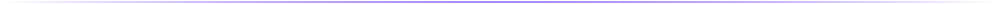
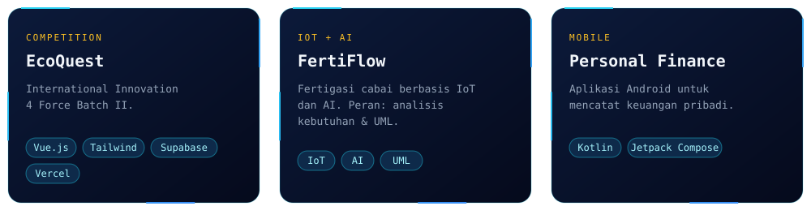

  
  
  

<h3>✦ Hello, World</h3>

<h3>✦ Tech Stack</h3>

<h3>✦ Featured Projects</h3>

 

<h3>✦ GitHub</h3>

  

<picture>
  <source media="(prefers-color-scheme: dark)" srcset="https://raw.githubusercontent.com/raztven/raztven/output/github-snake-dark.svg"/>
  <source media="(prefers-color-scheme: light)" srcset="https://raw.githubusercontent.com/raztven/raztven/output/github-snake.svg"/>
  
</picture>

<h3>✦ Let's Connect</h3>

  

made with obsession by <a href="https://github.com/raztven">raztven</a>

