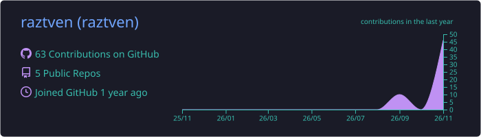
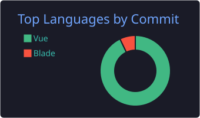

  
  
  

<h3>✦ About</h3>

<table>
  <tr>
    <td align="right">🎓 education</td>
    <td><b>D4 Teknologi Rekayasa Perangkat Lunak · Politeknik Negeri Lampung</b></td>
  </tr>
  <tr>
    <td align="right">💼 role</td>
    <td><b>Software Engineer · Full-Stack · Mobile Developer</b></td>
  </tr>
  <tr>
    <td align="right">🔭 currently</td>
    <td>building impactful software solutions 🚀</td>
  </tr>
  <tr>
    <td align="right">🤝 open to</td>
    <td>Freelance · Internship · Collaboration</td>
  </tr>
</table>

<h3>✦ Tech Stack</h3>

<table>
  <tr>
    <td align="right">languages</td>
    <td></td>
  </tr>
  <tr>
    <td align="right">frameworks</td>
    <td></td>
  </tr>
  <tr>
    <td align="right">data &amp; tools</td>
    <td></td>
  </tr>
  <tr>
    <td align="right">design &amp; editor</td>
    <td></td>
  </tr>
</table>

<h3>✦ Featured Projects</h3>

<table>
  <tr>
    <td align="center" width="33%">
      <a href="https://github.com/raztven/EcoQuest"><b>🌱 EcoQuest</b></a> 
      Tulis deskripsi singkat di sini  
      
    </td>
    <td align="center" width="33%">
      <a href="https://github.com/raztven/AbsenSiswa"><b>📋 AbsenSiswa</b></a> 
      Tulis deskripsi singkat di sini  
      
    </td>
    <td align="center" width="33%">
      <a href="https://github.com/raztven/V2peternak"><b>🐄 V2peternak</b></a> 
      Tulis deskripsi singkat di sini  
      
    </td>
  </tr>
</table>

<h3>✦ GitHub Stats</h3>

<h3>✦ Contribution Snake</h3>

<picture>
  <source media="(prefers-color-scheme: dark)" srcset="https://raw.githubusercontent.com/raztven/raztven/output/github-snake-dark.svg"/>
  <source media="(prefers-color-scheme: light)" srcset="https://raw.githubusercontent.com/raztven/raztven/output/github-snake.svg"/>
  
</picture>

<h3>✦ Let's Connect</h3>

  

made with obsession by <a href="https://github.com/raztven">raztven</a>

  

