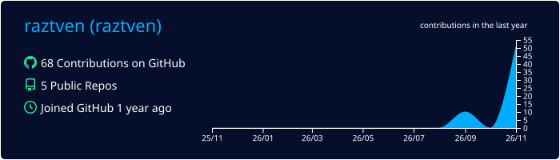
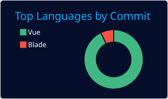

  
  
  

<h3>✦ Hello, World</h3>

<h3>✦ Tech Stack</h3>

<h3>✦ Featured Projects</h3>

<table>
  <tr>
    <td align="center" width="33%" valign="top">
      <a href="https://github.com/raztven/EcoQuest"><b>🌱 EcoQuest</b></a> 
      Environmental innovation web platform for <i>International Innovation 4 Force Batch II</i>.  
      <code>Vue.js · Tailwind · Supabase</code>
    </td>
    <td align="center" width="33%" valign="top">
      <b>🌶️ FertiFlow</b> 
      Automated chili fertigation powered by IoT &amp; AI. Led requirement analysis &amp; UML design.  
      <code>IoT · AI · UML Design</code>
    </td>
    <td align="center" width="33%" valign="top">
      <a href="https://github.com/raztven/AbsenSiswa"><b>📋 AbsenSiswa</b></a> · <a href="https://github.com/raztven/V2peternak"><b>🐄 V2peternak</b></a> 
      Full-stack academic attendance &amp; livestock management systems, plus Kotlin Finance app.  
      <code>Laravel · Kotlin · MySQL</code>
    </td>
  </tr>
</table>

<h3>✦ GitHub</h3>

  
  

<picture>
  <source media="(prefers-color-scheme: dark)" srcset="profile-summary-card-output/algolia/0-profile-details.svg"/>
  <source media="(prefers-color-scheme: light)" srcset="profile-summary-card-output/default/0-profile-details.svg"/>
  
</picture>
<picture>
  <source media="(prefers-color-scheme: dark)" srcset="profile-summary-card-output/algolia/2-most-commit-language.svg"/>
  <source media="(prefers-color-scheme: light)" srcset="profile-summary-card-output/default/2-most-commit-language.svg"/>
  
</picture>

  

<h3>✦ Let's Connect</h3>

  
  
  
  

made with obsession by <a href="https://github.com/raztven">raztven</a>

 

