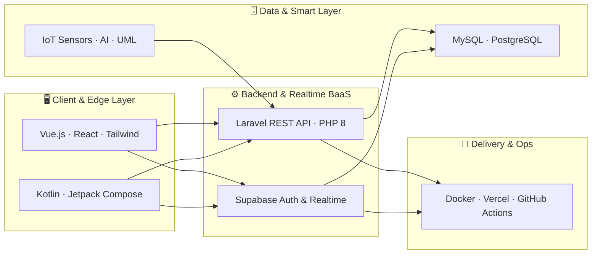
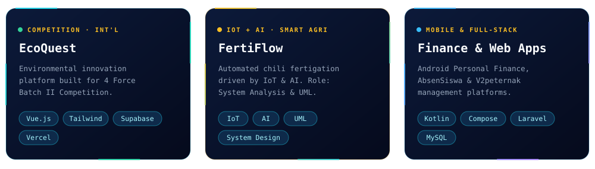
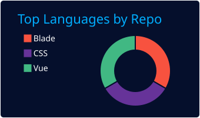
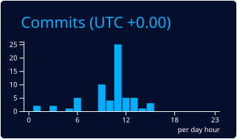

  
  
  

  
  
  
  
  

<h3>✦ Hello, World // Developer Console</h3>

⚡ <b>[Click to Expand] System Architecture &amp; Engineering Workflow</b>

 

| Engineering Principle | Implementation Approach |
| :--- | :--- |
| **Clean Architecture** | Modular MVC / MVVM separation with maintainable, readable codebases |
| **System Design First** | Requirement analysis, ERD normalization, and UML modeling before coding |
| **Product-Oriented UI** | Responsive layouts, accessible contrast, and smooth micro-interactions |

🎓 <b>[Click to Expand] Profile, Education &amp; Core Focus (D4 TRPL Polinela)</b>

 

| Attribute | Details |
| :--- | :--- |
| **Full Name** | **Farras Fadhil Hassan** (`@raztven`) |
| **Program** | D4 Teknologi Rekayasa Perangkat Lunak (TRPL) — **Politeknik Negeri Lampung** |
| **Base** | Bandar Lampung, Indonesia (`UTC+7`) |
| **Primary Focus** | Full-Stack Web (`Laravel`, `Vue.js`, `React`), Android (`Kotlin`, `Jetpack Compose`), IoT + AI System Design |
| **Availability** | Open for **Software Engineering Internships**, **Freelance Web/Mobile**, and **Competition / Research Teams** |

<h3>✦ Tech Stack &amp; Orbital Ecosystem</h3>

 

🧩 <b>[Click to Explore] Full Categorized Tech Stack &amp; Tooling Matrix</b>

 

| Domain | Technologies &amp; Frameworks |
| :--- | :--- |
| **Frontend &amp; UI** |       |
| **Backend &amp; APIs** |     |
| **Mobile &amp; Smart Systems** |    |
| **Database &amp; BaaS** |    |
| **DevOps &amp; Design** |       |

<h3>✦ Featured Projects &amp; Innovations</h3>

 

<table>
  <tr>
    <td width="50%" valign="top">
      <h4>🌱 <a href="https://github.com/raztven/EcoQuest">EcoQuest</a> — <code>Competition · Web App</code></h4>
      
Environmental innovation platform built for <b>International Innovation 4 Force Batch II</b>, combining interactive green challenges with realtime cloud persistence.

      

        
        
        
        
      

      
    </td>
    <td width="50%" valign="top">
      <h4>🌶️ FertiFlow — <code>IoT + AI · Smart Agriculture</code></h4>
      
Automated chili fertigation system powered by IoT environmental sensors and AI decision logic. Led <b>requirements engineering</b>, workflow specification &amp; <b>UML modeling</b>.

      

        
        
        
      

      
    </td>
  </tr>
  <tr>
    <td width="50%" valign="top">
      <h4>📋 <a href="https://github.com/raztven/AbsenSiswa">AbsenSiswa</a> — <code>Full-Stack · EdTech</code></h4>
      
Streamlined student attendance and academic record web application designed for fast daily tracking, clean reporting, and structured database integrity.

      

        
        
        
      

      
    </td>
    <td width="50%" valign="top">
      <h4>🐄 <a href="https://github.com/raztven/V2peternak">V2peternak</a> — <code>Full-Stack · AgriTech</code></h4>
      
Integrated digital livestock management and monitoring web system helping farm operators manage cattle records, feeding schedules, and health logs.

      

        
        
        
      

      
    </td>
  </tr>
</table>

📱 <b>[Click to Expand] Mobile &amp; Experimental Projects (Android Personal Finance &amp; More)</b>

 

- **💳 Personal Finance Android App (`Kotlin` + `Jetpack Compose`)**: Native Material 3 mobile application for recording daily expenses, categorizing budgets, and tracking personal cashflow cleanly offline-first.
- **🤖 GitHub Profile Automation (`GitHub Actions`)**: Automated CI workflows regenerating contribution snake animations and multi-theme telemetry SVG cards every 12–24 hours.

<h3>✦ GitHub Telemetry &amp; Contribution Matrix</h3>

  
  
  

<picture>
  <source media="(prefers-color-scheme: dark)" srcset="profile-summary-card-output/algolia/0-profile-details.svg"/>
  <source media="(prefers-color-scheme: light)" srcset="profile-summary-card-output/default/0-profile-details.svg"/>
  
</picture>

 

<picture>
  <source media="(prefers-color-scheme: dark)" srcset="profile-summary-card-output/algolia/3-stats.svg"/>
  <source media="(prefers-color-scheme: light)" srcset="profile-summary-card-output/default/3-stats.svg"/>
  
</picture>
<picture>
  <source media="(prefers-color-scheme: dark)" srcset="profile-summary-card-output/algolia/1-repos-per-language.svg"/>
  <source media="(prefers-color-scheme: light)" srcset="profile-summary-card-output/default/1-repos-per-language.svg"/>
  
</picture>
<picture>
  <source media="(prefers-color-scheme: dark)" srcset="profile-summary-card-output/algolia/4-productive-time.svg"/>
  <source media="(prefers-color-scheme: light)" srcset="profile-summary-card-output/default/4-productive-time.svg"/>
  
</picture>

  

<picture>
  <source media="(prefers-color-scheme: dark)" srcset="https://raw.githubusercontent.com/raztven/raztven/output/github-snake-dark.svg"/>
  <source media="(prefers-color-scheme: light)" srcset="https://raw.githubusercontent.com/raztven/raztven/output/github-snake.svg"/>
  
</picture>

<h3>✦ Let's Connect &amp; Collaborate</h3>

  
  
  
  

🤝 <b>[Click to Open] Collaboration &amp; Internship Quick-Card</b>

 

- **Looking For**: Software Engineering Internships, Full-Stack Web / Android Freelance Projects, and Tech Competition Collaborations.
- **Direct Email**: [`farrasfadhilhasan@gmail.com`](mailto:farrasfadhilhasan@gmail.com)
- **GitHub / LinkedIn**: [`@raztven`](https://github.com/raztven) · [`linkedin.com/in/raztven`](https://linkedin.com/in/raztven)

 

