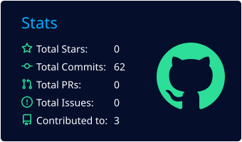

  
  
  

<h3>✦ Developer Console</h3>

⚡ <b>[Click to Open] System Architecture (Mermaid) &amp; Engineer Profile</b>

 

| Profile | Details |
| :--- | :--- |
| **Engineer** | **Farras Fadhil Hassan** (`@raztven`) |
| **Education** | D4 Teknologi Rekayasa Perangkat Lunak (TRPL) — **Politeknik Negeri Lampung** |
| **Focus** | Full-Stack Web (`Laravel`, `Vue.js`, `React`), Android (`Kotlin`, `Compose`), IoT + AI & UML Modeling |
| **Status** | Open for **Software Engineering Internships**, **Freelance**, and **Tech Competitions** |

<h3>✦ Tech Stack</h3>

🧩 <b>[Click to Open] Categorized Tech &amp; Tooling Matrix</b>

 

| Domain | Stack |
| :--- | :--- |
| **Frontend** |      |
| **Backend** |     |
| **Mobile** |    |
| **Data &amp; Ops** |      |

<h3>✦ Featured Projects</h3>

  
  
  

🌱 <b>EcoQuest</b> — <code>International Innovation 4 Force Batch II</code> · <code>Vue.js · Tailwind · Supabase · Vercel</code>

 

Environmental innovation web platform built for **International Innovation 4 Force Batch II**, featuring interactive eco-challenges and realtime cloud persistence powered by Supabase.

🌶️ <b>FertiFlow</b> — <code>Smart Chili Fertigation (IoT + AI)</code> · <code>System Analysis · UML Architecture</code>

 

Automated chili fertigation system driven by IoT environmental sensors and AI decision logic. Led **requirements engineering**, system workflow specification, and **UML modeling**.

📋 <b>AbsenSiswa</b> &amp; 🐄 <b>V2peternak</b> — <code>Full-Stack Management Platforms</code> · <code>Laravel · PHP · MySQL</code>

 

- **[AbsenSiswa](https://github.com/raztven/AbsenSiswa)**: Streamlined student attendance and academic tracking system designed for fast daily recording and structured reporting.
- **[V2peternak](https://github.com/raztven/V2peternak)**: Integrated digital livestock management platform for monitoring cattle records, feeding schedules, and farm health logs.

💳 <b>Personal Finance</b> — <code>Native Android Finance Tracker</code> · <code>Kotlin · Jetpack Compose</code>

 

Native Material 3 Android application for recording daily expenses, categorizing budgets, and tracking personal cashflow cleanly offline-first.

<h3>✦ GitHub Telemetry &amp; Cyber Matrix</h3>

  

<picture>
  <source media="(prefers-color-scheme: dark)" srcset="profile-summary-card-output/algolia/3-stats.svg"/>
  <source media="(prefers-color-scheme: light)" srcset="profile-summary-card-output/default/3-stats.svg"/>
  
</picture>
<picture>
  <source media="(prefers-color-scheme: dark)" srcset="profile-summary-card-output/algolia/1-repos-per-language.svg"/>
  <source media="(prefers-color-scheme: light)" srcset="profile-summary-card-output/default/1-repos-per-language.svg"/>
  
</picture>
<picture>
  <source media="(prefers-color-scheme: dark)" srcset="profile-summary-card-output/algolia/4-productive-time.svg"/>
  <source media="(prefers-color-scheme: light)" srcset="profile-summary-card-output/default/4-productive-time.svg"/>
  
</picture>

<h3>✦ Let's Connect</h3>

  
  
  
  

